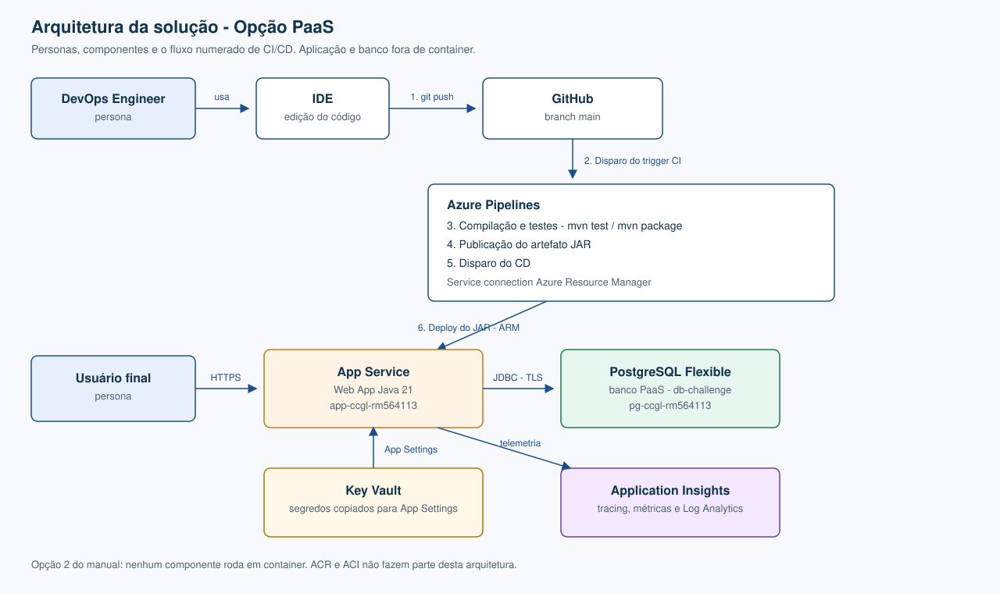

# challenge-2026-java-spint1

**Veti** é a API REST de uma clínica veterinária (Spring Boot / Java 21). Ela autentica o veterinário, persiste tutores, pets e consultas no PostgreSQL e expõe o CRUD por HTTPS.

**Opção 2 — PaaS, sem container:** o JAR roda no Azure App Service e o banco é o Azure Database for PostgreSQL Flexible Server. ACR e ACI não fazem parte desta entrega.

**Time CCGL** · Turma **2TDSPW**

| RM | Nome | Turma |
|---|---|---|
| 564113 | Camilo Micheletto da Silva | 2TDSPW |
| 564968 | Carlos André Silva | 2TDSPW |
| 562700 | Guilherme Ribeiro da Costa | 2TDSPW |
| 566376 | Laura Lopes Cruz | 2TDSPW |

## Stack

| Camada | Tecnologia |
|---|---|
| API | Java 21, Spring Boot 4, Spring Security (JWT) e login Google opcional |
| Persistência | Spring Data JPA, PostgreSQL |
| Contrato | OpenAPI / Swagger UI em `/veti/swagger-ui.html` |
| Observabilidade | Actuator (`GET /health`), log JSON, OpenTelemetry e Application Insights |
| Testes | JUnit 5 + Mockito no padrão AAA (`./mvnw test`) e Newman (`api-tests/`) |
| Entrega | [`azure-pipelines.yml`](azure-pipelines.yml): CI na `main` e em pull request, CD só na `main` |

## Benefícios para o negócio

A clínica deixa de depender do notebook de quem desenvolveu a API. Tutores, pets e a agenda de consultas ficam num banco gerenciado, com backup e TLS a cargo do PostgreSQL Flexible Server. O veterinário entra com JWT (ou Google, quando configurado) e o cadastro fica disponível por HTTPS. Senha do banco, segredo do JWT e a connection string do Application Insights não vão para o Git: a pipeline injeta o que estiver nas variáveis do Azure DevOps e preserva o que o App Service já tiver. Health check, log com id de correlação e tracing mostram se a API, o banco ou o login Google caíram, sem precisar reproduzir o erro na máquina local.

## Arquitetura



1. Push para o GitHub (`git push` na branch `main`)
2. Disparo do trigger de CI
3. Compilação e testes (`./mvnw test` e `./mvnw package`)
4. Publicação do artefato JAR
5. Disparo do CD, autenticado pela service connection ARM `azure-rm-challenge`
6. Deploy no App Service `app-ccgl-rm564113`, com injeção das variáveis de banco e do health check em `/health`

Em runtime o usuário chama a API por HTTPS, a Web App grava no PostgreSQL por JDBC e envia telemetria ao Application Insights quando `APPLICATIONINSIGHTS_CONNECTION_STRING` está definida.

## Banco de dados

O DDL oficial, com tabelas, PKs, FKs e comentários, está em [`script_bd.sql`](script_bd.sql). O fluxo de homologação usa `TB_TUTOR` (pai) e `TB_PET` (filho). No App Service o padrão é `DDL_AUTO=update`, que aplica o mesmo modelo via Hibernate. Use `DDL_AUTO=validate` quando o schema já tiver sido criado por esse script.

## Como auditar a entrega

A API avaliada está no App Service. A raiz `/` não tem página. O health check público é `GET /health`.

```bash
curl -sS https://app-ccgl-rm564113.azurewebsites.net/health
./mvnw test
npx newman run api-tests/veti.postman_collection.json \
  --env-var baseUrl=https://app-ccgl-rm564113.azurewebsites.net/veti \
  --env-var healthUrl=https://app-ccgl-rm564113.azurewebsites.net/health
```

Swagger: https://app-ccgl-rm564113.azurewebsites.net/veti/swagger-ui.html

O `Dockerfile` e o `docker-compose.yml` sobem só um PostgreSQL local para desenvolvimento. O deploy da disciplina é o JAR no App Service, na seção abaixo. Login Google local pede client id e secret e a redirect `http://localhost:8080/veti/login/oauth2/code/google`. Sem essas variáveis a API sobe só com JWT.

## Variáveis de ambiente

| Variável | Obrigatória | Descrição |
|---|---|---|
| `DB_URL`, `DB_USER`, `DB_PASSWORD` | sim | Conexão PostgreSQL |
| `JWT_SECRET` | sim (produção) | Segredo de assinatura do JWT |
| `GOOGLE_CLIENT_ID`, `GOOGLE_CLIENT_SECRET` | não | Ativam o login com Google. Sem elas a API sobe só com login JWT |
| `DDL_AUTO` | não | Padrão `update`. Use `validate` quando o schema for criado pelo script SQL oficial |
| `PORT` / `SERVER_PORT` | não | Porta HTTP (padrão 8080) |
| `LOG_FORMAT` | não | Formato do log no console: `logstash` (padrão), `ecs` ou `gelf` |
| `OTEL_EXPORT_ENABLED` | não | `true` para exportar traces e métricas via OTLP/HTTP |
| `OTEL_EXPORTER_OTLP_ENDPOINT` | não | Endpoint do coletor OTLP (padrão `http://localhost:4318`) |
| `APPLICATIONINSIGHTS_CONNECTION_STRING` | não | Anexa o agente do Azure Application Insights (traces, métricas e logs) |
| `TRACING_SAMPLING_PROBABILITY` | não | Amostragem de traces (padrão `1.0`) |

## Observabilidade

- **Health check**: `GET /health` (fora do context-path, liberado sem autenticação). Verifica processo (`ping`, `livenessState`, `readinessState`), PostgreSQL (`db`) e, quando o login Google está ativo, o provedor OAuth (`googleOAuth`). Falha do Google retorna `DEGRADED` (HTTP 200) para não reiniciar a instância por causa de um terceiro; falha do banco retorna `DOWN` (HTTP 503).
- **Logs**: JSON (Logstash) no stdout, com `traceId`, `spanId` e `correlationId` em cada linha. O header `X-Correlation-Id` (ou `X-Request-Id`) é aceito e devolvido; sem ele, o `traceId` é usado. Cada requisição gera um log de acesso INFO (2xx/3xx), WARN (4xx) ou ERROR (5xx).
- **Tracing**: OpenTelemetry via Micrometer. Spans de HTTP (controller) → service (`@Observed`) → JDBC (`connection`/`query`, via datasource-micrometer).
- **Métricas**: `http.server.requests` (tempo de resposta com percentis p50/p95/p99 e taxa de erro pelas tags `outcome`/`status`), `veti.service`, `jdbc.*`, JVM e Tomcat. Exportadas por OTLP e consultáveis em `/veti/actuator/metrics` (requer ADMIN).

Teste local de exportação com um coletor OpenTelemetry:

```bash
OTEL_EXPORT_ENABLED=true OTEL_EXPORTER_OTLP_ENDPOINT=http://localhost:4318 java -jar target/veti-0.0.1-SNAPSHOT.jar
```

## Testes

Testes unitários (padrão AAA, Mockito, não precisam de banco):

```bash
./mvnw test
```

Testes de API (Postman/Newman) em [api-tests/veti.postman_collection.json](api-tests/veti.postman_collection.json), com a API rodando:

```bash
npx newman run api-tests/veti.postman_collection.json \
  --env-var baseUrl=https://app-ccgl-rm564113.azurewebsites.net/veti \
  --env-var healthUrl=https://app-ccgl-rm564113.azurewebsites.net/health
```

Para uma API local, troque as URLs por `http://localhost:8080/veti` e `http://localhost:8080/health`.

Casos cobertos: health check com banco, registro + login JWT, bloqueio sem token, criar tutor, criar pet com FK do tutor, pet com tutor inexistente (404), criar consulta, excluir consulta (e confirmar 404) e limpeza. O workflow [.github/workflows/ci.yml](.github/workflows/ci.yml) roda tudo isso no GitHub Actions com PostgreSQL.

## Scripts Azure CLI

Os scripts da Opção 2 estão na raiz deste repositório, junto com o código:

| Arquivo | Função |
|---|---|
| `azure_create_infra.sh` | Cria App Service, PostgreSQL, Key Vault, Application Insights, gera o JAR e faz o deploy |
| `azure_test_infra.sh` | Confere Web App, PostgreSQL, Application Insights e `GET /health` |
| `azure_test_crud.sh` | CRUD HTTP e SELECT de conferência |
| `azure_delete_infra.sh` | Apaga o Resource Group e faz purge do Key Vault |
| `tests/run_newman.sh` | Newman contra a API publicada |

```bash
chmod +x azure_*.sh tests/run_newman.sh
./azure_test_infra.sh
./tests/run_newman.sh
```

Recriar a infra exige `az login` e `export PG_ADMIN_PASSWORD='...'` antes de `./azure_create_infra.sh`. O script usa este repositório como fonte quando o `mvnw` está na mesma pasta.

## Deploy no Azure App Service (JAR, sem container)

A esteira versionada é [`azure-pipelines.yml`](azure-pipelines.yml).

1. No Azure DevOps, crie a pipeline a partir desse arquivo, na branch `main`.
2. A service connection de Azure Resource Manager precisa se chamar `azure-rm-challenge`.
3. Nas variáveis da pipeline (secret), preencha quando quiser que o CD regrave os App Settings: `DB_URL`, `DB_USER`, `DB_PASSWORD`, `JWT_SECRET` e `APPLICATIONINSIGHTS_CONNECTION_STRING`. Variável vazia não apaga o valor que o App Service já tem.
4. Um push na `main` dispara o CI (`./mvnw test`, pacote, artefato `drop`) e, se os testes passarem, o CD publica o JAR em `app-ccgl-rm564113` e aponta o health check para `/health`. Pull request roda só o CI.

Deploy manual do mesmo artefato, com Java 21:

```bash
./mvnw test
./mvnw -DskipTests package
```

O JAR fica em `target/veti-0.0.1-SNAPSHOT.jar`. O `Dockerfile` e o `docker-compose.yml` servem só para desenvolvimento local.
