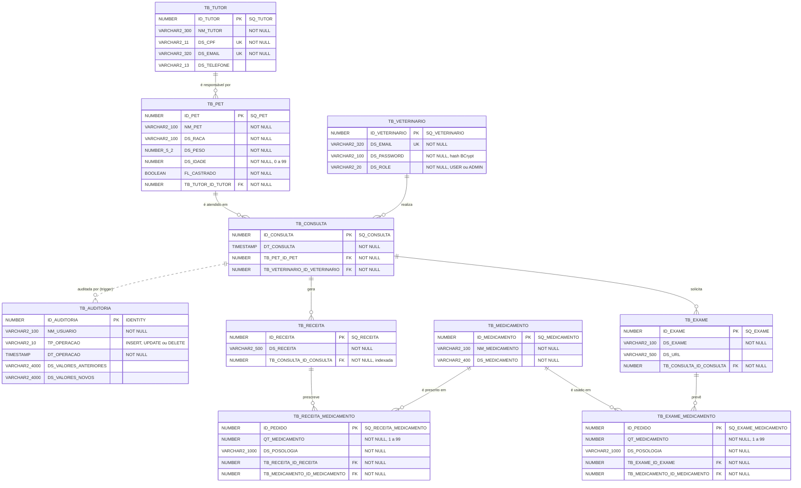

# Modelo de dados (MER/DER) — Veti

Banco: **Oracle Database 23ai**. As tabelas e sequences são criadas pelo Hibernate a partir das entidades em [`src/main/java/br/com/fiap/veti/entity`](../src/main/java/br/com/fiap/veti/entity). A `TB_AUDITORIA`, o package `PKG_VETI` e a trigger `TRG_AUDITORIA_CONSULTA` vêm de [`pkg_veti.sql`](../src/main/resources/db/pkg_veti.sql).

- Modelo físico (DDL gerado pelo Hibernate): [`ddl-oracle.sql`](ddl-oracle.sql)
- Objetos PL-SQL: [`pkg_veti.sql`](../src/main/resources/db/pkg_veti.sql)

## Diagrama entidade-relacionamento

## Entidades e regras

| Tabela | Descrição | Regras principais |
|---|---|---|
| `TB_TUTOR` | Responsável pelo pet | CPF (11 dígitos) e e-mail únicos |
| `TB_PET` | Animal acompanhado pela clínica | Pertence a um tutor; peso > 0; idade de 0 a 99 |
| `TB_VETERINARIO` | Conta de acesso da equipe | E-mail único; senha em BCrypt validada antes pela `PKG_VETI.FN_VALIDA_SENHA`; perfil USER ou ADMIN |
| `TB_CONSULTA` | Atendimento agendado | Um veterinário não pode ter duas consultas no mesmo horário (`TB_CON_DT_VET_UN`) |
| `TB_EXAME` | Exame pedido numa consulta | — |
| `TB_MEDICAMENTO` | Catálogo de medicamentos | — |
| `TB_EXAME_MEDICAMENTO` | Medicamento associado a um exame | Quantidade de 1 a 99 |
| `TB_RECEITA` | Receita emitida numa consulta | — |
| `TB_RECEITA_MEDICAMENTO` | Itens da receita | Quantidade de 1 a 99 |
| `TB_AUDITORIA` | Histórico de alterações em consultas | Preenchida pela trigger `TRG_AUDITORIA_CONSULTA`; sem FK, para guardar também exclusões |

## Objetos PL-SQL (`PKG_VETI`)

| Objeto | Tipo | Uso na aplicação |
|---|---|---|
| `FN_MONTA_JSON` | Função | Monta JSON manualmente (sem funções nativas de JSON); usada pela `PRC_CONSULTAS_JSON` |
| `FN_VALIDA_SENHA` | Função | Chamada no cadastro de veterinário (`VeterinarioService.cadastrar`) |
| `PRC_CONSULTAS_JSON` | Procedure | `GET /relatorios/consultas-json` e tela **Relatórios** |
| `PRC_RESUMO_CONSULTAS` | Procedure | `GET /relatorios/resumo-consultas` e tela **Relatórios** |
| `TRG_AUDITORIA_CONSULTA` | Trigger | Grava `TB_AUDITORIA`; exibida em `GET /relatorios/auditoria-consultas` |
